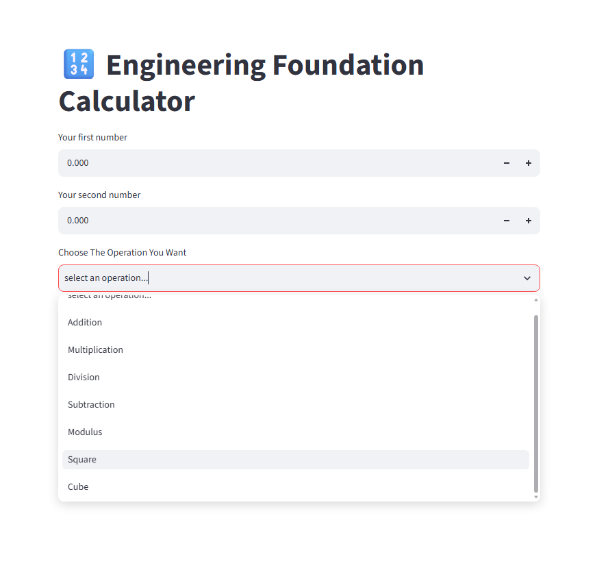
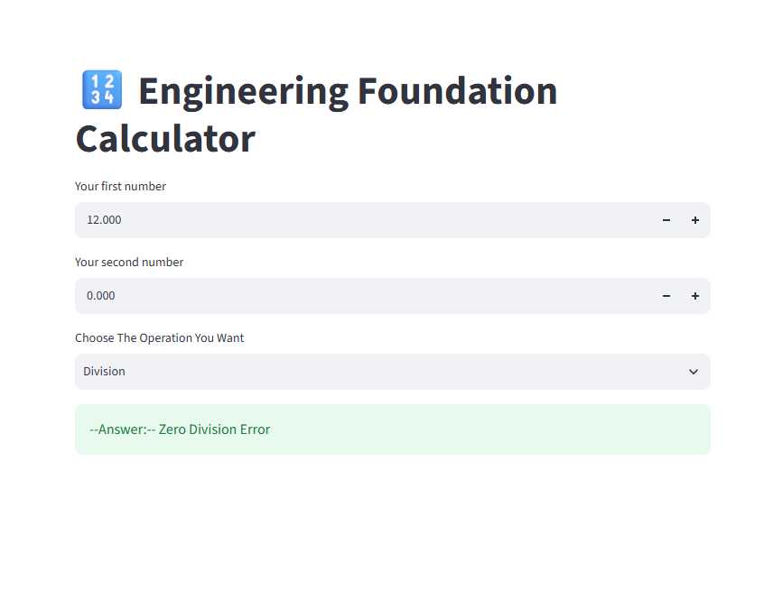
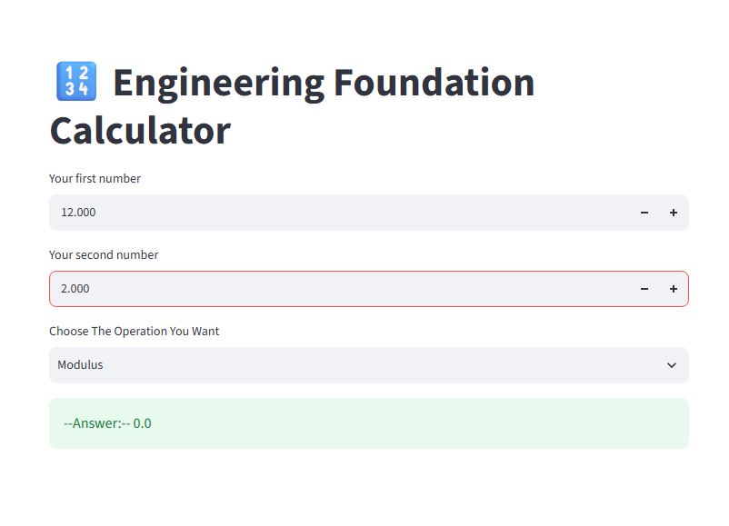

# Engineering Foundation Calculator

A simple interactive calculator built using **Python and Streamlit**. This project demonstrates the use of Python functions, modular programming, and building a basic web interface with Streamlit.

## Features

The calculator supports seven mathematical operations:

| Operation | Description |
|---|---|
| Addition | Adds two numbers |
| Subtraction | Subtracts the second number from the first |
| Multiplication | Multiplies two numbers |
| Division | Divides the first number by the second |
| Modulus | Returns the remainder after division |
| Square | Calculates the square of the first number |
| Cube | Calculates the cube of the first number |

### Additional Features

- Interactive web interface using Streamlit.
- Number inputs supporting decimal values up to three displayed decimal places.
- Dropdown menu for selecting mathematical operations.
- Separate Python functions for mathematical calculations.
- Tested handling of division-by-zero and modulus-by-zero cases.

## Application Preview

### Calculator Interface



### Calculator Example





> I leave the rest for you, try it and submit a pull request for the rest of the screenshots. 

## Tech Stack

- **Language:** Python 3.14.4
- **Frontend / UI:** Streamlit 1.66.1
- **Code Organization:** Modular Python functions
- **Dependency Management:** pip and requirements.txt

## Project Structure

```text
project_1/
│
├── screenshots/
│   ├── Calculator_Interface.png
│   ├── Division_Example.png
│   └── Modulus_Example.png
│
├── app.py
├── src.py
├── requirements.txt
├── README.md
└── .gitignore
```

## Installation and Setup

### Prerequisites

- Python 3.14.4
- pip

### 1. Clone the repository

```bash
git clone <repository-url>
```

### 2. Navigate to the project directory

```bash
cd python/projects/project_1
```

### 3. Create a virtual environment

```bash
python -m venv .venv
```

### 4. Activate the virtual environment

**Linux / macOS:**

```bash
source .venv/bin/activate
```

**Windows:**

```bash
.venv\Scripts\activate
```

### 5. Install dependencies

```bash
pip install -r requirements.txt
```

### 6. Run the application

```bash
streamlit run app.py
```

The application will open in your browser.

## Implementation

The project follows a modular structure:

- `app.py`: Handles the Streamlit interface, user inputs, operation selection, and result display.
- `src.py`: Contains independent Python functions for mathematical operations.

This separation keeps the calculation logic independent of the user interface.

## Learning Objectives

- Implementing and calling Python functions.
- Understanding modular programming and importing functions between Python files.
- Handling user input through Streamlit.
- Building interactive web applications.
- Practicing basic error handling.
- Managing project dependencies and virtual environments.

## Project Status

**Completed** — Beginner Python project as part of Engineering Foundation.

## Contributions

Contributions are welcome!

Feel free to contribute to this project by adding new features, improving existing functionality, fixing bugs, enhancing the user interface, or suggesting new ideas.

The goal is to continuously improve this project through collaboration, experimentation, and learning.

**Fork the repository, make your improvements, and submit a pull request. Every meaningful contribution helps make this project better and helps you become a better developer.