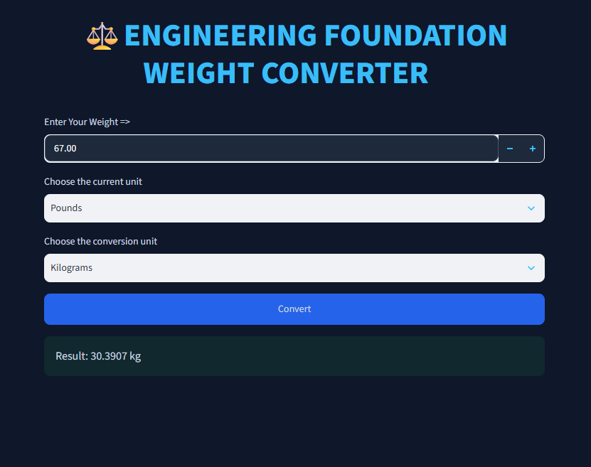
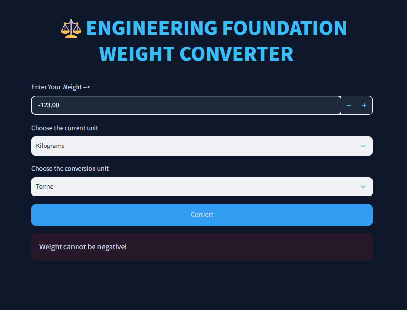

# Weight Converter

An interactive weight conversion application built using **Python and Streamlit**. This project demonstrates the use of Python dictionaries, functions, modular programming, mathematical calculations, and building a customized web interface with Streamlit.

## Features

The converter supports five weight units:

| Unit | Symbol | Description |
|---|---|---|
| Kilograms | kg | Standard metric unit of mass |
| Pounds | lbs | Commonly used imperial unit |
| Milligrams | mg | One-thousandth of a gram |
| Grams | g | One-thousandth of a kilogram |
| Tonne | t | Equivalent to 1,000 kilograms |

### Additional Features

- Interactive web interface using Streamlit.
- Number input supporting decimal values.
- Dropdown menus for selecting source and destination units.
- Conversion between all five supported weight units.
- Dictionary-based conversion factors for managing unit relationships.
- Separate Python function for conversion calculations.
- Input validation to prevent negative weight values.
- Custom dark-themed interface using CSS.
- Styled input fields, dropdown menus, buttons, and result display.
- Conversion results displayed up to four decimal places.

## Application Preview

### Pounds to Kilograms Conversion



### Negative Weight Validation



## Tech Stack

- **Language:** Python 3.14.4
- **Frontend / UI:** Streamlit 1.66.1
- **Styling:** Custom CSS
- **Code Organization:** Modular Python functions
- **Dependency Management:** pip and requirements.txt
- **Code Quality:** Ruff

## Project Structure

```text
project_2/
│
├── [screenshots/](screenshots/)
│   ├── [Pounds_to_Kilograms_example.png](screenshots/Pounds_to_Kilograms_example.png)
│   └── [negative_value_example.png](screenshots/negative_value_example.png)
│
├── [app.py](app.py)
├── [src.py](src.py)
├── [requirements.txt](requirements.txt)
├── [README.md](README.md)
└── [.gitignore](.gitignore)
```

## Installation and Setup

### Prerequisites

- Python 3.14.4
- pip

### 1. Clone the repository

```bash
git clone <repository-url>
```

### 2. Navigate to the project directory

```bash
cd python/projects/project_2
```

### 3. Create a virtual environment

```bash
python -m venv .venv
```

### 4. Activate the virtual environment

**Linux / macOS:**

```bash
source .venv/bin/activate
```

**Windows:**

```bash
.venv\Scripts\activate
```

### 5. Install dependencies

```bash
pip install -r requirements.txt
```

### 6. Run the application

```bash
streamlit run app.py
```

The application will open in your browser.

## Implementation

The project follows a modular structure:

- `app.py`: Handles the Streamlit interface, user inputs, unit selection, input validation, and result display. It also contains custom CSS for interface styling.
- `src.py`: Contains the conversion factors dictionary and the independent `convert_weight()` function responsible for performing weight conversions.
- `requirements.txt`: Contains the project dependencies and their specified versions.

### Conversion Logic

The application uses kilograms as the common reference unit for all conversions.

Each supported unit has a conversion factor representing its equivalent value in kilograms.

The conversion follows two steps:

1. Convert the input weight into kilograms.
2. Convert the kilogram value into the selected destination unit.

**Formula:**

```python
weight_in_kg = weight * conversion_factors[from_unit]

result = weight_in_kg / conversion_factors[to_unit]
```

This approach avoids writing separate conversion formulas for every possible unit combination.

## Learning Objectives

- Understanding Python dictionaries and key-value pairs.
- Implementing and calling Python functions.
- Understanding modular programming and importing functions between Python files.
- Performing mathematical calculations using conversion factors.
- Handling user input through Streamlit.
- Building interactive web applications.
- Customizing application interfaces using CSS.
- Implementing basic input validation and error handling.
- Managing project dependencies and virtual environments.

## Project Status

**Completed** — Beginner Python project as part of Engineering Foundation.

## Contributions

Contributions are welcome!

Feel free to contribute to this project by adding new features, improving existing functionality, fixing bugs, enhancing the user interface, or suggesting new ideas.

The goal is to continuously improve this project through collaboration, experimentation, and learning.

**Fork the repository, make your improvements, and submit a pull request. Every meaningful contribution helps make this project better and helps you become a better developer.