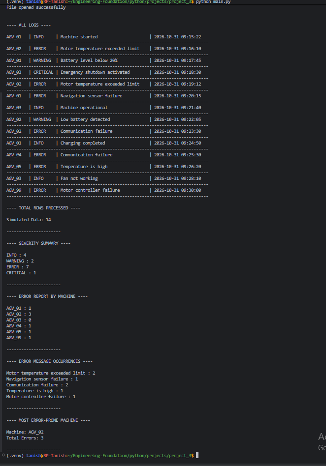
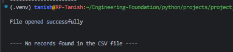
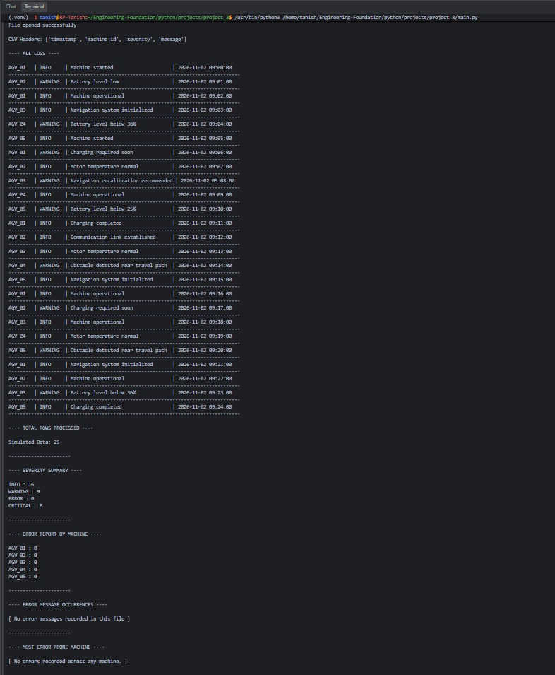

# Industrial Log Intelligence CLI

A beginner-level Python command-line application that reads synthetic industrial equipment logs from CSV files and generates summary reports.

## Project Status

| Item | Details |
|---|---|
| Version | V1.0 |
| Level | Beginner |
| Language | Python 3 |
| Input | CSV |
| Interface | CLI |
| Dependencies | Standard library only |

## Features — V1.0

- Read and display CSV records.
- Count records by severity: INFO, WARNING, ERROR and CRITICAL.
- Count ERROR records by machine ID.
- Identify recurring ERROR messages.
- Identify the machine with the highest ERROR count.
- Display total records processed.
- Handle empty files, zero-error datasets and missing files.

**Note:** Machine-level and recurring-error statistics use only records with severity `ERROR`. `CRITICAL` records are counted separately.

## Requirements

- Python 3
- No third-party packages required.

## How to Run

Open a terminal in the project directory and run:

```bash
python3 main.py
```

The CSV path is currently configured directly in `main.py`. Change the path in the `open()` statement to test another dataset.

## Input CSV Format

```csv
timestamp,machine_id,severity,message
2026-11-02 09:00:00,UNIT_01,INFO,Machine started
```

Supported severity labels: `INFO`, `WARNING`, `ERROR`, `CRITICAL`.

## Sample Datasets

| File | Purpose |
|---|---|
| `machine_log.csv` | Normal dataset |
| `empty_log.csv` | Empty-file handling |
| `no_error.csv` | Dataset without ERROR records |

## Screenshots

**Normal dataset**

[View normal dataset screenshot](screenshots/machine_log_csv_example.png)



**Empty dataset**

[View empty dataset screenshot](screenshots/empty_log_csv_example.png)



**Dataset without ERROR records**

[View zero-error dataset screenshot](screenshots/no_error_csv_example.png)



## Project Structure

```text
project_3/
├── data/
├── development-notes/
├── docs/
├── screenshots/
├── .gitignore
├── main.py
├── requirements.txt
└── README.md
```

## Testing

Manually tested with normal, empty, zero-error and missing-file scenarios. V1.0 does not include automated tests.

## Documentation

- [V1 Development Journal](docs/V1_JOURNAL.md)
- [V1 Error and Correction Record](development-notes/V1_ERROR_CORRECTION_RECORD.md)

## Limitations

- Uses synthetic data, not live equipment telemetry.
- Does not connect to physical machines or controllers.
- No database, API, GUI or machine learning.
- Expects the specified CSV headers and severity labels.

This is a learning project, not an industrial monitoring or safety system.

## Roadmap

| Version | Planned work | Status |
|---|---|---|
| V1.0 | CSV reading and basic log analysis | Completed |
| V2.0 | Functions and code organisation | Planned |
| V3.0 | Filtering and sorting | Planned |
| V4.0 | Pandas and Matplotlib visualisation | Planned |
| V5.0 | Automated testing and final documentation | Planned |

All included records are synthetic examples.