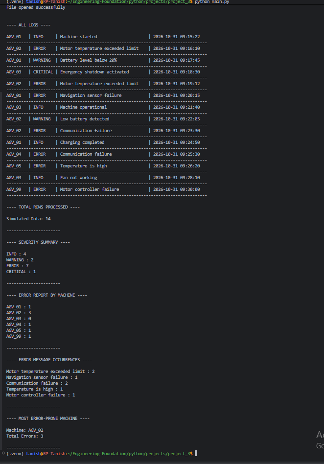
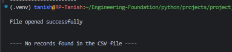
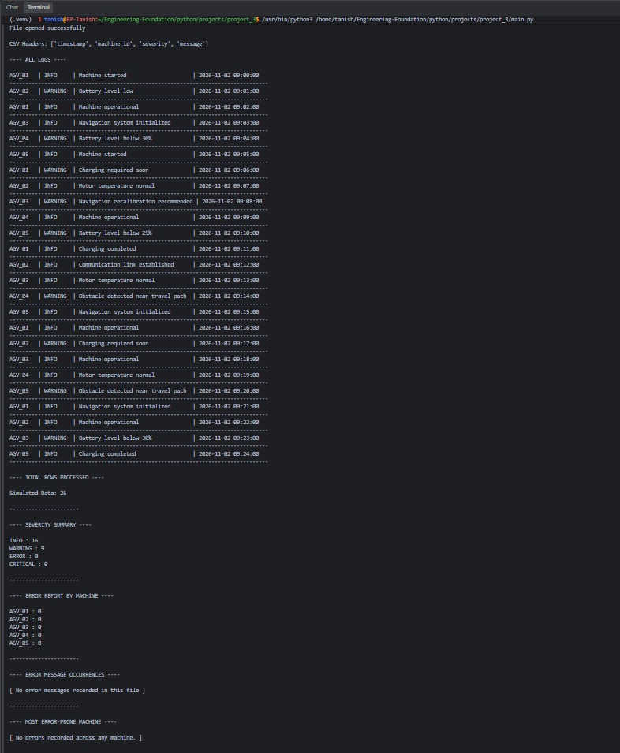

Industrial Log Intelligence CLI
V1.0 — Development Journal
Project detail	Description
Project level	Beginner Python project
Version	V1.0
Language	Python
Input format	CSV
Interface	Command-line interface (CLI)
Data source	Synthetic industrial equipment log records
Dependencies	Python standard library (csv)
Status	V1 implementation completed; Git release pending

1. Project Overview
Industrial Log Intelligence CLI is a small command-line application that reads simulated industrial equipment log records from a CSV file and produces a basic analysis in the terminal.

The project was created to practise Python fundamentals through a practical data-processing task. It works with local, synthetic data. It does not connect to physical equipment, collect live telemetry, or use data from an employer.
2. Objectives and V1 Scope
The objective of V1 was to build a working CSV-based log analyser using beginner-level Python concepts. The scope was deliberately limited so the project could focus on reading structured data, processing records, maintaining counts, and presenting results.

V1 includes:
1. Read records from a CSV file using csv.DictReader.
2. Display each record in a readable, aligned terminal format.
3. Count records by severity: INFO, WARNING, ERROR, and CRITICAL.
4. Count ERROR records for each machine ID.
5. Count repeated error messages.
6. Identify the machine with the highest recorded error count.
7. Display the total number of records processed.
8. Handle a missing input file and a file containing no records.
Out of scope for V1
V1 does not include live equipment connectivity, real-time monitoring, predictive maintenance, machine learning, database storage, an API, a graphical interface, cloud deployment, or comprehensive CSV schema validation. These exclusions keep the project at the intended beginner level; they are not unfinished V1 features.
3. How the Program Works
The program follows this sequence:
1. Open the input file. The program opens the selected CSV file in read mode using a with open(...) statement.
2. Read the CSV structure. csv.DictReader uses the column headers as dictionary keys and provides each data record as a dictionary.
3. Load the records. The reader is converted to a list so the program can check whether records exist before processing them.
4. Handle an empty input. If the list contains no records, the program displays a no-records message instead of entering the analysis loop.
5. Process each record. For every record, the program extracts the timestamp, machine ID, severity, and message.
6. Update the counters. Dictionaries store severity totals, error totals by machine, and occurrences of each error message.
7. Generate the report. The program displays the records and then prints the summary statistics, machine-level error counts, recurring error messages, and the most error-prone machine when errors exist.
8. Handle a missing file. A FileNotFoundError handler displays a readable message if the input path does not exist.
The expected CSV header is:
timestamp,machine_id,severity,message
Severity values are expected to match the four categories used by the program: INFO, WARNING, ERROR, and CRITICAL.
4. Python Concepts Practised
Concept	How it was used
Variables and basic data types	Store record values and running totals.
Lists	Store the CSV records after reading them.
Dictionaries	Maintain severity totals, per-machine error counts, and error-message counts.
for loops	Process records and print report entries.
Conditional statements	Handle empty input, distinguish error records, and report zero-error results.
File handling	Open and read CSV files with with open(...).
csv.DictReader	Read each CSV record as a dictionary keyed by its header.
F-strings	Format machine records into aligned terminal columns.
Exception handling	Handle a missing input file with FileNotFoundError.
Built-in functions	Use list(), len(), any(), and max() during processing and reporting.

5. Development Issues and Learning
Several problems were found while building and testing V1. They were resolved by inspecting the code, checking program output, and examining the input files. The main issues were:
- The program initially displayed report headings even when the input contained no records. The records were stored in a list and checked before the analysis section ran.
- An earlier version attempted to iterate over the original CSV reader after it had already been consumed by list(reader). The processing loop was changed to use the stored list.
- The ALL LOGS heading appeared in the wrong place. The output section was reorganised so the heading appears before the record loop and only when records exist.
- Checking whether the machine-count dictionary contained entries did not establish whether any machine had a non-zero error count. The program now uses any(Error_Count_By_Machine.values()) for that check.
- A blank line at the beginning of no_error.csv was interpreted as the header row, so the expected machine_id key was unavailable. Removing the blank line restored the correct header.
- Explanatory text had been appended to no_error.csv. Because it was not a valid CSV record—and contained commas—the reader treated parts of it as data, resulting in an unexpected severity value. Removing the text restored the dataset.
A separate file, V1_ERROR_CORRECTION_RECORD.md, documents these issues in a problem–cause–correction format for a more detailed debugging record.
6. Manual Testing and Evidence
V1 was tested manually by running the CLI against separate input files and a missing-file path. This version does not include an automated unit-test suite.
Test case	Input	Purpose	Expected behaviour
Normal dataset	machine_log.csv	Check the complete analysis path with machine records and severity values.	Display records and generate all summary reports.
Empty dataset	empty_data.csv	Check behaviour when there are no data records.	Display a no-records message without attempting the analysis loop.
Zero-error dataset	no_error.csv	Check a dataset containing INFO and WARNING records but no ERROR or CRITICAL records.	Count the records and severities, show zero machine errors, report no error messages, and state that no machine has recorded an error.
Missing-file case	A path that does not exist	Check file-access error handling.	Display the handled FileNotFoundError message.

Screenshot evidence
The following screenshots are stored in the project's top-level screenshots/ directory. The image paths are relative to this journal's location in docs/. They document the three CSV dataset scenarios and are evidence of manual testing, not automated test results.

## 5. Testing

The application was manually tested using different CSV datasets to verify its behaviour under normal and exceptional input conditions.

| Dataset | Test purpose |
|---|---|
| `machine_log.csv` | Verify normal log processing and statistical reports. |
| `empty_data.csv` | Verify handling of an empty CSV file. |
| `no_error.csv` | Verify correct reporting when no ERROR records exist. |

### Test 1 — Normal Dataset

### Test 2 — Empty Dataset

### Test 3 — Dataset Without Errors

The screenshots cover the three dataset scenarios above. The missing-file case was also tested, but a screenshot for it is not included in this evidence set.
7. Known Limitations
The following limitations are intentional in this beginner version:
- The input data is synthetic and does not represent live equipment telemetry or employer data.
- The program reads local CSV files only.
- It does not connect to physical equipment, controllers, sensors, or other industrial hardware.
- It does not store results in a database.
- It does not perform predictive maintenance, anomaly detection, or machine learning.
- It expects the CSV headers and severity values to match the format described in this journal. Comprehensive validation of malformed headers, unexpected severity values, and invalid rows is not part of V1.
- It is a command-line learning tool, not a production monitoring or safety system.
8. Next Planned Version
V2.0 — Refactoring with Python functions

The next version will reorganise the existing working logic into a small number of functions. The purpose will be to practise function definitions, parameters, return values, and separation of responsibilities—not to introduce an advanced architecture or change the project's beginner-level scope.

V1 should remain preserved as the first working release. V2 work should be made in subsequent commits rather than silently changing the V1 release.